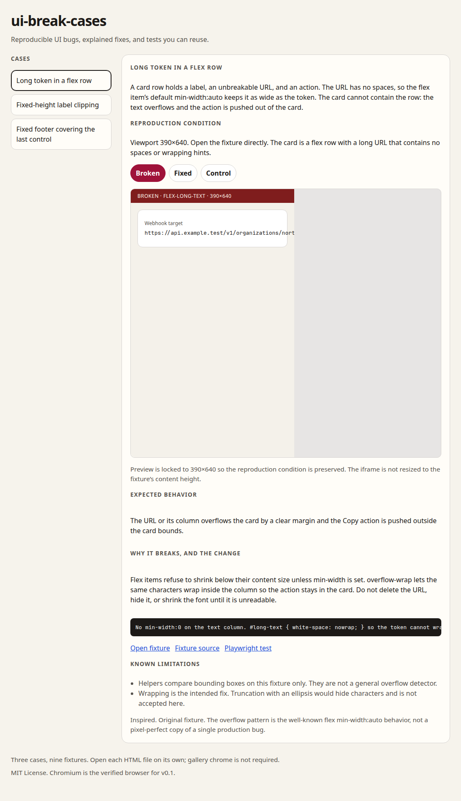

# ui-break-cases

Reproducible UI bugs, explained fixes, and tests you can reuse.

This repository is a small, local collection of interface failures. Each case ships with a broken fixture, a fix that keeps the content and the control, a valid-by-design control, and a Playwright test that asserts the defect or its absence.

It is for people who write UI tests or CSS and want a concrete example to copy. It is not a scanner, a benchmark, or a claim that these are the only bugs that matter.



## Requirements

- Node.js 22 or newer (see `.nvmrc`)
- npm 10+
- Playwright’s Chromium browser (installed separately, see below)

## Install and run

```bash
npm ci
npm run dev
```

`npm run dev` serves the gallery at [http://127.0.0.1:5173/](http://127.0.0.1:5173/). Fixtures are also reachable on their own, for example [http://127.0.0.1:5173/fixtures/flex-long-text/broken.html](http://127.0.0.1:5173/fixtures/flex-long-text/broken.html).

Production build:

```bash
npm run typecheck
npm run build
npm run preview
```

`npm run preview` serves `dist/` at [http://127.0.0.1:4173/](http://127.0.0.1:4173/). The Vite `base` is `./`, so asset and fixture URLs stay relative and the same `dist/` folder can be published as a GitHub Pages project site.

`npm run build:pages` bakes absolute `/ui-break-cases/` asset URLs. Upload the contents of `dist/` as that project site. Vite’s preview server does not remount `public/` files under the prefix; GitHub Pages does, because it serves the whole `dist/` tree at `/ui-break-cases/`.

## Chromium for Playwright

v0.1 verifies Chromium only.

```bash
npx playwright install chromium
```

On Linux CI images, install OS dependencies as well:

```bash
npx playwright install --with-deps chromium
```

Then:

```bash
npm test
```

`npm test` builds the production bundle, previews it, and runs Playwright against that server. Tests open fixture HTML directly with the viewport declared in `src/cases.ts`. They do not drive the gallery iframes.

## Cases

| Case | Broken | Fixed | Control |
| --- | --- | --- | --- |
| `flex-long-text` (390×640) | An unbreakable URL overflows a flex row and pushes **Copy** out of the card. | `min-width: 0` and `overflow-wrap: anywhere` keep the same URL and the action inside the card. | A code block uses local `overflow-x: auto`. The page does not grow sideways. |
| `fixed-height-label` (390×640) | A one-line height plus `overflow: hidden` clips a multi-line status sentence. | Height follows the text. The next block stays below it. | Intentional truncation with **Show full summary**. The expanded state is tested. A `title` attribute is not the recovery path. |
| `fixed-footer-overlap` (360×500) | After scrolling to the end, a `position: fixed` footer covers **Confirm booking**. | `padding-bottom` reserves the footer height. | The same fixed bar with a matching spacer, which is valid. |

Each case lives in `public/fixtures/<id>/{broken,fixed,control}.html`, is listed in `src/cases.ts`, and is covered by `tests/<id>.spec.ts`.

## Adapt a test to another component

The assertions are small and geometric. They are written for these fixtures, not as a universal scanner.

Example, from the flex case:

1. Point Playwright at your component instead of `fixtures/flex-long-text/broken.html`.
2. Set the same narrow viewport you care about.
3. Compare the text box (or the action) to the card with a few pixels of tolerance.
4. Keep the original string in the document. A pass that deletes the URL is not a fix.
5. Hit-test the action with `document.elementFromPoint` *before* clicking it.

```ts
const card = await page.locator("#card").boundingBox();
const action = await page.locator("#action").boundingBox();
// action.right <= card.right + 4
```

For clipped text, `Range.getClientRects()` plus the container’s box and `overflow` is enough on a static label. For a fixed footer, scroll to the end first, measure overlap, then call `elementFromPoint` — a click can `scrollIntoView` and hide the bug.

Copy the helper that matches your bug from `tests/helpers.ts`. Do not treat those helpers as production detectors.

## What v0.1 checks

- Three cases, nine variants, all load as standalone HTML.
- Broken tests pass by asserting the defect. They are not skipped and not marked as expected failures.
- Fixed tests keep the original copy and check that the control still works.
- Control tests check the intentional behavior, including the expanded summary.
- `npm ci`, `npm run typecheck`, `npm run build`, `npm run preview`, and `npm test` (Chromium) are the supported commands.
- The gallery is keyboard-usable and keeps footer iframes at 360×500.

Limitations:

- Chromium only.
- Geometry helpers are fixture-specific.
- No URL scanner, backend, accounts, LLM, MCP, browser extension, npm publish, or extra cases.
- Screenshots are evidence, not the assertion.

## Contribute

See [docs/adding-a-case.md](docs/adding-a-case.md). Open a pull request against `main`. Keep the scope small: one case, three variants, one test file, a gallery entry.

## Related reading

These projects are useful neighbors. ui-break-cases does not replace them.

- [Flexbugs](https://github.com/philipwalton/flexbugs)
- [Defensive CSS](https://defensivecss.dev)
- [MDN: overflow-wrap](https://developer.mozilla.org/en-US/docs/Web/CSS/overflow-wrap)
- [MDN: position](https://developer.mozilla.org/en-US/docs/Web/CSS/position)

## License

[MIT](LICENSE)
